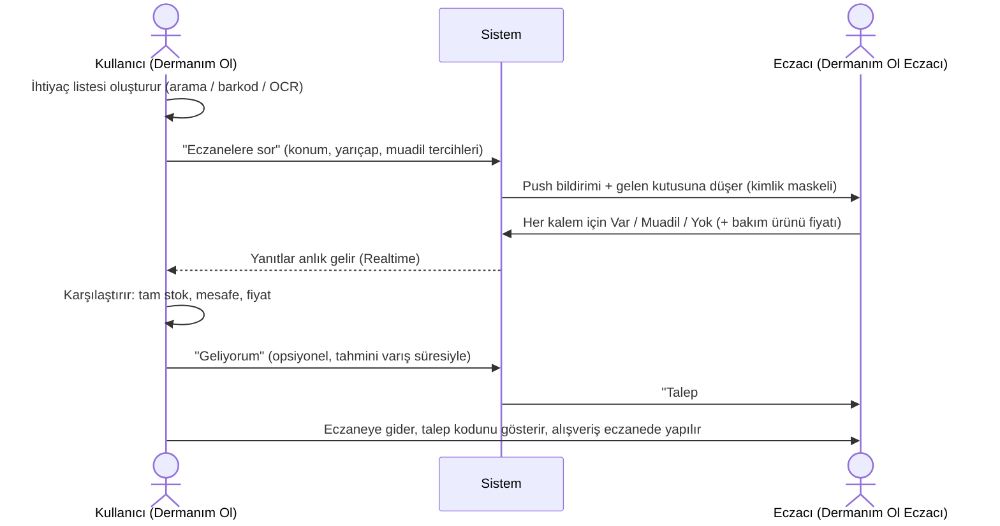
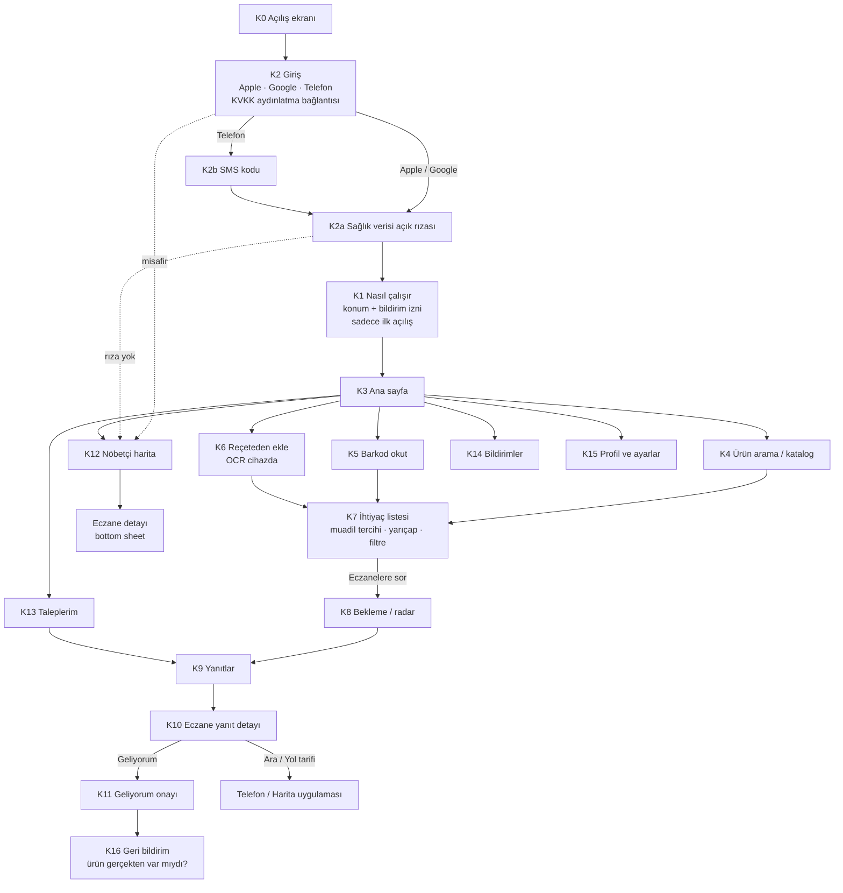
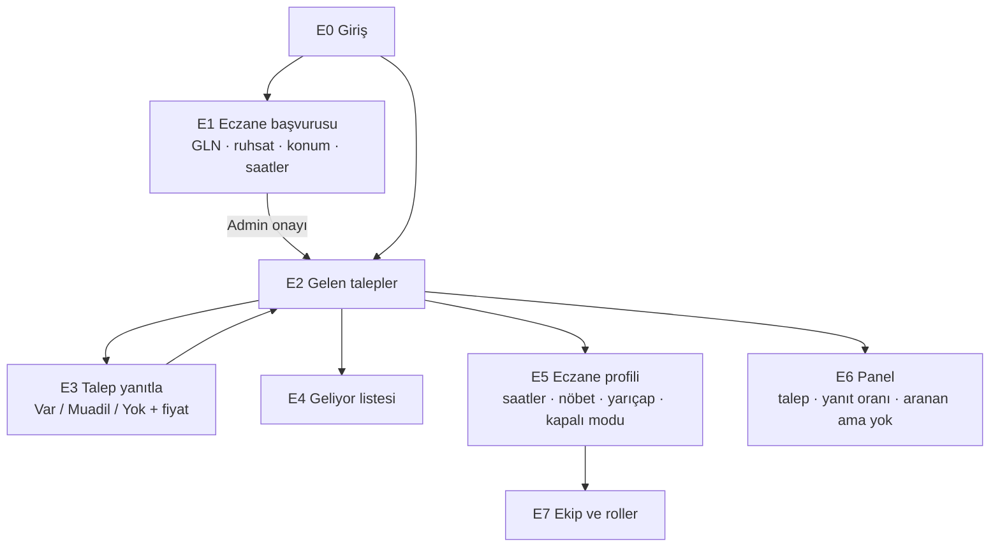

# Dermanım Ol: Ekran Akış Haritası

> Durum: Taslak v1 · Tarih: 2026-11-02
> Kararların dayanağı: [01-urun-kararlari.md](01-urun-kararlari.md)

---

## 1. Ana akış (kullanıcı ve eczacı)



## 2. Durum makineleri

**Talep**
```
Taslak → Gönderildi → Yanıtlanıyor → Kapandı
Kapanma nedenleri: süre doldu / kullanıcı kapattı / eşleşen eczane yok (hemen kapanır)
"Geliyorum" talebi kapatmaz. Talep başına en fazla 2 aktif "Geliyorum" olabilir.
Yanıt süresi: gündüz 10 dakika, gece (22:00–08:00) 15 dakika.
```

**Eczane yanıtı**
```
Bekliyor → Yanıtlandı → (süre dolana kadar) Düzeltildi
Bekliyor → Süresi doldu (yanıt yok)
Bekliyor → İptal (kullanıcı talebi kapattı, eczacının listesinden silinir)
Bekliyor → Atlandı (eczane kapalı ya da 20'den fazla bekleyen talebi var)
```

**Geliyorum**
```
Aktif → Geldi
Aktif → Gelmedi (süre aşıldı)
Aktif → İptal (kullanıcı vazgeçti)
```

---

## 3. Dermanım Ol: kullanıcı uygulaması (iOS, Android)



| Kod | Ekran | İçerik ve kurallar | Kaynak tasarım | İşlem |
|---|---|---|---|---|
| K0 | Açılış ekranı | Dermanım Ol logosu, "Dermanın cebinde, eczanen yanında." sloganı, yükleme çubuğu | `assets/marka/splash.png` | **"T.C. Sağlık Bakanlığı İTS" rozeti kaldırılacak** |
| K2 | Giriş | Uygulama ikonu ve "Dermanım Ol" adı. Butonlar: **Apple ile giriş**, **Google ile giriş**, **Telefon numarasıyla devam**. "Devam ederek KVKK Aydınlatma Metni'ni ve Kullanım Koşulları'nı okuduğunu kabul edersin" bağlantısı (metin tam ekran açılır). "Üye olmadan nöbetçi eczaneleri gör". **TC kimlik ve şifre yok** | `giri_yap_h_zl_ke_fet` | Yeniden çizilecek |
| K2b | SMS kodu | Sadece telefonla girenler için 6 haneli kod. Apple ve Google ile girenlerden **ilk "Sor" anında bir kez** istenir (kötüye kullanım önlemi) | `sms_do_rulama_telefon_teyidi` | Uyarlanacak |
| K2a | Açık rıza | Sağlık verisi için açık rıza (zorunlu, talep göndermek için), kampanya izni (isteğe bağlı). Rıza vermeyen sadece nöbetçi haritasını kullanır | — | **Yeni** |
| K1 | Nasıl çalışır ve izinler | 3 kart, konum ve bildirim izni. Sadece ilk açılışta | `splash_giri_onboarding_ge_i_animasyonu` | Uyarlanacak |
| K3 | Ana sayfa | "Ne arıyorsun?" arama çubuğu, hızlı aksiyonlar (Barkod, Reçeteden ekle, Nöbetçi), aktif talep kartı, son talepler | — | **Yeni** |
| K4 | Ürün arama | TİTCK ilaç listesi ve bakım kataloğu. Ürün adı, etken madde ve muadil bilgisi gösterilir. Buton: "Listeye ekle" | `i_la_muadil_otc_arama_katalo_u` | "Sepete ekle", indirim ve "Vitrin fırsatı" kaldırılacak |
| K5 | Barkod | Eski kutunun barkodunu okutup ürünü listeye ekleme | `re_ete_tarama_viz_r_ocr` (vizör kısmı) | Uyarlanacak |
| K6 | Reçeteden ekle | OCR cihazda çalışır, çıkan ürün adları onaylanır. **Fotoğraf saklanmaz ve gönderilmez** | `re_ete_tarama_viz_r_ocr`, `re_ete_detay_i_la_do_rulama` | Medula, TC kimlik ve "İTS doğrulama" ifadeleri kaldırılacak |
| K7 | İhtiyaç listesi | Kalemler ve adetleri, kalem başına "muadil olur" seçeneği, "sadece tamamı olanlar" seçeneği, yarıçap kaydırıcısı, "Şimdi açık / Nöbetçi" filtresi | `re_ete_y_kle_teklif_i_ste_1/2` | **TC kimlik ve e-reçete numarası alanları kaldırılacak.** Tercih bölümleri korunacak |
| K8 | Bekleme / radar | Kaç eczaneye ulaşıldığı, gelen yanıt sayacı, kalan süre, "ekranı kapatabilirsin" notu, reklam alanı (gece ve nöbetçide kapalı) | `teklif_radar_canl_bekleme`, `re_ete_tarama_teklif_radar_ge_i_animasyonu` | "Teklif" dili "yanıt" olarak değişecek |
| K9 | Yanıtlar | 3 grup: ✅ Hepsi var, 🔁 Muadille tamam, ⚠️ Kısmi. "2 eczanede tamamlanır" kombinasyon kartı. Rozetler: 📍 mesafe, ✅ x/y rafta, 🏷️ bakım fiyatı | `gelen_eczane_teklifleri` | "Teklifi incele ve seç", kampanya ve "Eczacıyla görüş" kaldırılacak |
| K10 | Yanıt detayı | Kalem kalem durum, önerilen muadilin adı ve etken maddesi, bakım ürünü fiyatları, adres, çalışma saati. Aksiyonlar: Ara, Yol tarifi, Geliyorum | `teklif_detay_teslimat` | Teslimat ve kurye seçenekleri kaldırılacak |
| K11 | Geliyorum | Tahmini varış süresi (15 / 30 / 60 dk), talep kodu ekranda büyük gösterilir, iptal. Kombinasyon önerisinde ikinci eczaneye de "Geliyorum" denebilir (en fazla 2) | `stok_teyit_rezervasyon_onay` | "Rezervasyon" dili "Geliyorum" olacak, barkod yerine talep kodu |
| K12 | Nöbetçi harita | Harita ve liste, eczane detay bottom sheet'i. Arama ve yol tarifi. Misafir kullanıcıya da açık | `n_bet_i_eczaneler_canl_harita`, `n_bet_i_eczane_detay_bottom_sheet` | **"İEO resmi verisi", "GPS doğrulaması" ve "Reçete gönder" kaldırılacak** |
| K13 | Taleplerim | Geçmiş talepler, "Tekrar sor". **Geçmiş telefonda tutulur**, sunucudaki kayıt 24 saatte anonimleşir | — | Yeni |
| K14 | Bildirimler | Yanıt geldi, süre doldu, sistem bildirimleri | `bildirim_merkezi_sistem_uyar_lar` | Uyarlanacak |
| K15 | Profil ve ayarlar | Bildirim tercihleri, KVKK aydınlatma metni ve açık rıza, **hesap silme** (App Store zorunluluğu) | `profil_aktif_i_la_takip_listesi` | İlaç takip listesi Faz 3'e taşınacak |
| K16 | Geri bildirim | "Ürün gerçekten var mıydı?" sorusu. Sadece iç kalite skoru için, **herkese açık puan yok** | `hasta_de_erlendirme_eczane_puanlama` | Sadeleştirilecek |

---

## 4. Dermanım Ol Eczacı (telefon, tablet, web)



| Kod | Ekran | İçerik ve kurallar | Kaynak tasarım | İşlem |
|---|---|---|---|---|
| E0 | Giriş | E-posta veya telefon ve OTP. Davetli personel girişi | — | Yeni |
| E1 | Eczane başvurusu | Eczane adı, GLN, ruhsat no, oda sicil no, adres ve harita pini, çalışma saatleri, belge yükleme. Durum: "Onay bekleniyor" | `eczane_medikal_ba_vuru_formu` | Cari hesap ve banka alanları kaldırılacak |
| E2 | Gelen talepler | Canlı liste: talep kodu, mesafe, kalem sayısı, kalan süre. Push bildirimi ve sesli uyarı | `n_bet_i_eczane_stok_gece_rezervasyon` (liste kısmı) | Uyarlanacak |
| E3 | Talep yanıtla | **15 saniyede yanıt hedefi.** Kalem başına büyük butonlar: [Var] [Muadil ▾] [Yok]. Muadil, TİTCK eşdeğer listesinden seçilir. Bakım ürünlerinde fiyat alanı (bayrakla). Hazırlık süresi. Gönder | `eczac_teklif_verme_re_ete_yan_tlama` | **Hasta adı, e-reçete belgesi, SGK katkı payı, fiyat dağılımı, kurye ve kullanım notu kaldırılacak** |
| E4 | Geliyor listesi | "Geliyorum" diyen talepler, tahmini varış, talep kodu, "Geldi / Gelmedi" işaretleme | `eczac_stok_onay_rezervasyon_barkodu` | Barkod ve rezervasyon dili değişecek |
| E5 | Eczane profili | Çalışma saatleri, nöbet günleri, yanıt yarıçapı, bildirim saatleri, **"Şu an kapalıyım" modu** | — | Yeni |
| E6 | Panel | Bu ay gelen talep sayısı, yanıt oranı, ortalama yanıt süresi, "Geliyorum" sayısı, **bölgede aranan ama stokta olmayan ürünler** | `kasa_finansal_rapor` (görsel dil) | Finans ve kasa içeriği kaldırılacak, yeni metrikler eklenecek |
| E7 | Ekip | Eczacı ve personel kullanıcıları, roller (yanıtlayabilir / sadece görüntüler) | — | Yeni |

---

## 5. Dermanım Ol Yönetim (web)

| Kod | Ekran | İçerik | Kaynak tasarım |
|---|---|---|---|
| A1 | Eczane başvuruları | Onay / ret, GLN ve ruhsat kontrol notu | `ba_vuru_onay_cari_hesap_a_l` (cari hesap kısmı kaldırılacak) |
| A2 | Eczaneler | Liste, askıya alma, yanıt kalitesi skoru | Yeni |
| A3 | Ürün kataloğu | TİTCK listesi içe aktarma, eşdeğer grupları, bakım ürünleri ve kategoriler (ilaç / bakım ayrımı) | Yeni |
| A4 | Kullanıcılar ve kötüye kullanım | Spam talepler, sahte "Geliyorum", engelleme | Yeni |
| A5 | Reklam ve sponsorluk | Bekleme ekranı reklam alanları, sponsorlu bakım ürünleri, kategori engelleri | `f_rsat_k_esi_reklam_vitrin_paketi` (görsel dil; **eczaneye değil markaya satılır**) |
| A6 | Raporlar | Talep hacmi, yanıt süresi, bölgesel yokluk haritası | Yeni |
| A7 | Ayarlar ve bayraklar | Yanıt süresi, yarıçap limitleri, günlük talep limiti, feature flag'ler (`price_quotes`, `waiting_ads`, `combo_suggestion`), pilot bölge açma | Yeni |
| A8 | İçerik | KVKK metinleri, SSS, onboarding metinleri | Yeni |

---

## 6. Kullanılmayacak tasarımlar

| Tasarım | Durum |
|---|---|
| `sepet_g_venli_deme`, `sepet_sanal_pos_deme_puan_ve_gelir_modeli`, `3d_secure_2.0_sms_otp_do_rulama`, `deme_ba_ar_l_sipari_onayland` | Backlog (ödeme yok) |
| `kurye_canl_takip_teslimat_onay`, `kurye_da_t_m_teslimat_ekran`, `teslimat_tamamland_i_la_hat_rlat_c` | Backlog (hatırlatıcı kısmı Faz 3'e) |
| `ayl_k_platform_mutabakat_cari_d_k_m` | Backlog |
| `apple_wallet_rezervasyon_kart` | İptal |
| `i_ptal_i_ade_canl_destek`, `eczac_i_ade_talebi_onay_i_ts_i_ptal`, `i_ade_onayland_bakiye_c_zdanda`, `sipari_haz_rlama_i_ts_onay` | İptal |
| `eczac_canl_dan_ma_sohbet` | Faz 2, hukuki görüşten sonra |
| `g_n_n_f_rsatlar_r_n_detay_popup` | Faz 2, marka sponsorluğu için |
| `i_lk_e_re_eteni_tan_mla` | İptal (yerine K1 onboarding) |
| 7 logo ve ikon klasörü | Yerine yeni Dermanım Ol logosu |

---

## 7. Özet sayılar

| Uygulama | MVP ekran sayısı | Mevcut tasarımdan uyarlanan |
|---|---|---|
| Dermanım Ol (kullanıcı) | 17 | 15 |
| Dermanım Ol Eczacı | 8 | 5 |
| Dermanım Ol Yönetim | 8 | 2 |
| **Toplam** | **33** | **22** |
