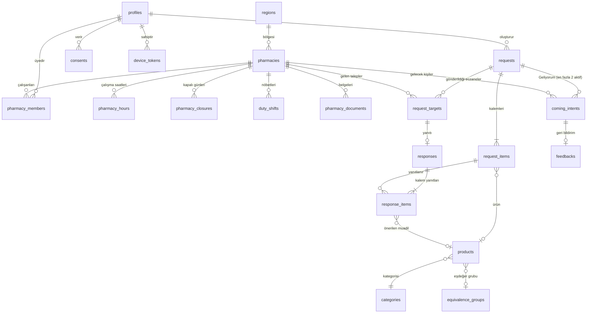
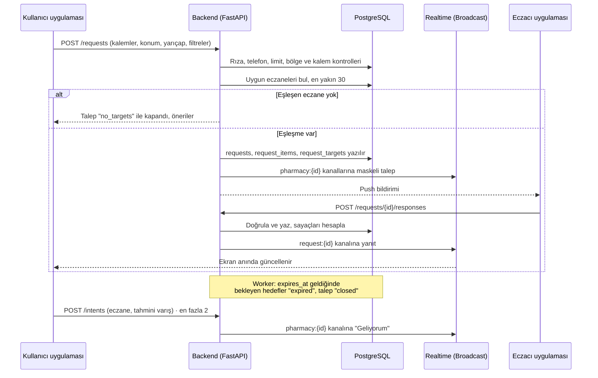

# Dermanım Ol: Veri Modeli

> Durum: Taslak v2 · Tarih: 2026-11-02
> Veritabanı: Supabase (PostgreSQL 15+, PostGIS, pg_trgm)
> Dayanak: [01-urun-kararlari.md](01-urun-kararlari.md), [02-ekran-akis-haritasi.md](02-ekran-akis-haritasi.md), [04-teknik-mimari.md](04-teknik-mimari.md)

Bu doküman tabloları, alanları, ilişkileri ve erişim kurallarını tanımlar. Migration SQL'i kodlama aşamasında bu dokümandan üretilecek. v1'e göre yapılan 18 düzeltme en sondaki **Değişiklik günlüğü** bölümünde listelenmiştir; metinde ilgili yerlerde `[D-n]` olarak işaretlidir.

---

## 1. Tasarım ilkeleri

1. **Eczacı kullanıcıyı tanımaz.** Eczacı tarafı `requests` tablosunu hiçbir zaman doğrudan okuyamaz. Ona sadece maskeli veri gider: talep kodu, 100 metreye yuvarlanmış mesafe ve kalemler.
2. **İstemci, durum değiştiren kayıtları doğrudan yazamaz.** Talep gönderme, yanıt verme, "Geliyorum" ve iptal işlemleri **backend** (FastAPI) üzerinden yapılır. RLS sadece okuma iznini düzenler.
3. **İlaçta fiyat yok** kuralı veritabanı seviyesinde uygulanır. Fiyat sadece katalogda `care` (bakım) olarak tanımlı ürünlerde girilebilir. Serbest metinle eklenen kalemlerde fiyat **hiçbir zaman** girilemez. `[D-3]`
4. **Asgari veri:** Reçete fotoğrafı, TC kimlik, ad-soyad ve adres tutulmaz. Konum yazılırken ~100 metreye yuvarlanır `[D-11]`. Kullanıcıya ait talep verisi **24 saat sonra anonimleştirilir**.
5. **Kullanıcının talep geçmişi telefonda tutulur.** "Taleplerim" ekranı ve "Tekrar sor" özelliği cihazdaki kayıtla çalışır. Sunucu 24 saatlik anonimleştirmeye devam eder. `[D-1]`
6. **Para karşılığı sıralama yoktur.** Eczane tablosunda öne çıkarma, öncelik ya da ödeme alanı bulunmaz.
7. **Canlı güncelleme özel Broadcast kanallarıyla yapılır.** Supabase Realtime'ın tablo değişikliği dinleme özelliği kullanılmaz; mesajları backend yayınlar. `[D-2]`
8. Bütün zamanlar `timestamptz` olarak tutulur, iş kurallarında `Europe/Istanbul` saat dilimi kullanılır.

---

## 2. Varlık-ilişki diyagramı

`public_holidays` tablosu bağımsızdır (tüm eczaneler için geçerli resmi tatiller). `[D-8]`

---

## 3. Sayılabilir tipler (enum)

| Enum | Değerler |
|---|---|
| `account_status` | `active`, `suspended`, `deleted` |
| `pharmacy_status` | `pending`, `approved`, `rejected`, `suspended` |
| `member_role` | `owner` (eczane sahibi eczacı), `pharmacist`, `staff` |
| `product_kind` | `drug` (ilaç), `care` (bakım, dermokozmetik, takviye, medikal) |
| `rx_class` | `prescription`, `otc`, `none` |
| `request_status` | `sent`, `collecting`, `closed` |
| `close_reason` | `expired`, `user_closed`, `no_targets` `[D-4][D-5]` |
| `target_status` | `pending`, `responded`, `expired`, `skipped` (eczane kapalı ya da yükü dolu), `cancelled` (kullanıcı talebi kapattı) |
| `availability` | `available`, `equivalent`, `unavailable` |
| `intent_status` | `active`, `arrived`, `no_show`, `cancelled` |
| `feedback_answer` | `yes`, `partial`, `no` |
| `consent_type` | `kvkk_notice` (aydınlatma), `explicit_health` (sağlık verisi açık rıza), `marketing` |
| `ad_placement` | `waiting_screen`, `sponsored_care` |
| `auth_method` | `apple`, `google`, `phone` |

v1'deki `user_role` enum'u kaldırıldı. `[D-6]`

---

## 4. Tablolar

### 4.1 Kimlik ve hesap

**`profiles`**: Supabase `auth.users` tablosunun uzantısı. Telefon numarası ve e-posta `auth.users` içinde kalır.
| Alan | Tip | Not |
|---|---|---|
| `id` | uuid PK | = `auth.users.id` |
| `is_admin` | bool | Varsayılan `false`. Admin girişinde iki aşamalı doğrulama (MFA) zorunlu `[D-6]` |
| `auth_method` | `auth_method` | İlk giriş yöntemi |
| `phone_verified_at` | timestamptz, boş olabilir | Apple ya da Google ile girenlerde ilk talepte doldurulur. **Boşsa talep gönderilemez** |
| `display_name` | text, boş olabilir | Sadece eczane personeli için. Kullanıcıdan istenmez |
| `status` | `account_status` | |
| `daily_request_limit` | int, boş olabilir | Boşsa `settings` değeri geçerli. Kötüye kullanımda düşürülür |
| `deleted_at` | timestamptz, boş olabilir | Hesap silme zamanı `[D-13]` |
| `created_at`, `updated_at` | timestamptz | |

Bir kişinin eczacı olup olmadığı rol alanından değil, **`pharmacy_members` üyeliğinden** anlaşılır. Aynı hesap hem kullanıcı hem eczacı uygulamasını kullanabilir. `[D-6]`

**`consents`**: KVKK onaylarının sürümlü kaydı.
| Alan | Tip | Not |
|---|---|---|
| `id` | uuid PK | |
| `user_id` | uuid FK → profiles | |
| `type` | `consent_type` | |
| `text_version` | text | Onaylanan metnin sürümü, ör. `kvkk-2026-11` |
| `granted_at`, `revoked_at` | timestamptz | Geri alma kaydı silinmez |

**`device_tokens`**: Push bildirim token'ları.
| Alan | Tip | Not |
|---|---|---|
| `user_id` | uuid FK | |
| `app` | text | `user` ya da `pharmacy` |
| `platform` | text | `ios`, `android`, `web` |
| `token` | text, unique | |
| `last_seen_at` | timestamptz | |

### 4.2 Eczane

**`pharmacies`**
| Alan | Tip | Not |
|---|---|---|
| `id` | uuid PK | |
| `name` | text | |
| `gln` | text, unique | Global Location Number |
| `license_no` | text | Ruhsat numarası |
| `chamber_registry_no` | text | Eczacı odası sicil numarası |
| `phone` | text | Eczanenin sabit hattı. Kullanıcıya gösterilir |
| `province`, `district`, `neighborhood`, `address_line` | text | |
| `location` | geography(Point, 4326) | GIST index |
| `region_id` | FK → regions | Pilot bölge |
| `status` | `pharmacy_status` | Sadece `approved` olan eczaneler talep alır |
| `response_radius_km` | numeric(4,1) | Eczanenin talep kabul ettiği yarıçap. Varsayılan 3 |
| `closed_override_until` | timestamptz, boş olabilir | "Şu an kapalıyım" modu |
| `quality_score` | numeric(4,3) | Yanıt doğruluğundan hesaplanır. **Sadece iç kullanım, sıralamada kullanılmaz** |
| `reviewed_by`, `reviewed_at`, `review_note` | | Admin onay bilgisi |
| `created_at`, `updated_at` | timestamptz | |

**`pharmacy_members`**
| Alan | Tip | Not |
|---|---|---|
| `pharmacy_id` | FK | PK (pharmacy_id, user_id) |
| `user_id` | FK → profiles | |
| `role` | `member_role` | **Bir kullanıcı en fazla bir eczanede `owner` olabilir** (kısmi unique index: `user_id WHERE role = 'owner'`). 6197 sayılı Kanun'daki tek eczane kuralı `[D-14]` |
| `can_respond` | bool | Talep yanıtlayabilir mi |
| `invited_by`, `joined_at` | | |

**`pharmacy_hours`**: Haftalık çalışma saatleri.
| Alan | Tip | Not |
|---|---|---|
| `pharmacy_id` | FK | |
| `weekday` | smallint | 1 = Pazartesi … 7 = Pazar |
| `opens_at`, `closes_at` | time | Gece yarısını geçen saatler desteklenir |

**`pharmacy_closures`**: Eczanenin planlı kapalı olduğu tarihler (izin, tadilat). `[D-8]`
| Alan | Tip | Not |
|---|---|---|
| `id`, `pharmacy_id` | | |
| `starts_at`, `ends_at` | timestamptz | |
| `reason` | text, boş olabilir | Sadece eczane görür |

**`public_holidays`**: Resmi tatiller. Bu günlerde normal çalışma saatleri geçersizdir, sadece nöbetçiler talep alır. `[D-8]`
| Alan | Tip | Not |
|---|---|---|
| `date` | date PK | |
| `name` | text | Ör. "Cumhuriyet Bayramı" |
| `half_day` | bool | Arife gibi yarım günler. Öğleden sonra kapalı sayılır |

**`duty_shifts`**: Nöbet günleri.
| Alan | Tip | Not |
|---|---|---|
| `id` | uuid PK | |
| `pharmacy_id` | FK | |
| `starts_at`, `ends_at` | timestamptz | |
| `source` | text | `manual` (eczacı girer). İleride oda verisi eklenebilir |

**`pharmacy_documents`**: Başvuru belgeleri. Dosyalar özel bir Storage bucket'ında tutulur.
| Alan | Tip | Not |
|---|---|---|
| `id`, `pharmacy_id` | | |
| `type` | text | `license`, `chamber_certificate`, `other` |
| `storage_path` | text | Sadece admin ve eczane sahibi okuyabilir |
| `uploaded_at` | timestamptz | |

**`regions`**: Pilot açılış bölgeleri.
| Alan | Tip | Not |
|---|---|---|
| `id` | PK | |
| `province`, `district` | text | |
| `boundary` | geography(MultiPolygon) | |
| `is_enabled` | bool | Talep sadece açık bölgelerde gönderilebilir |

### 4.3 Ürün kataloğu

**`categories`**
| Alan | Tip | Not |
|---|---|---|
| `id`, `parent_id`, `name` | | Ağaç yapısı |
| `kind` | `product_kind` | |
| `ads_blocked` | bool | İlaç kategorilerinde her zaman `true` |

**`equivalence_groups`**: Aynı etken madde, doz ve formdaki ilaçlar.
| Alan | Tip | Not |
|---|---|---|
| `id` | PK | |
| `label` | text | Ör. "Amoksisilin + Klavulanik asit 1000 mg film tablet" |
| `source` | text | `titck` ya da `manual` |

**`products`**
| Alan | Tip | Not |
|---|---|---|
| `id` | uuid PK | |
| `kind` | `product_kind` | |
| `name`, `brand` | text | Trigram index (arama için) |
| `barcode` | text, unique, boş olabilir | GTIN. Barkod okutma bu alanla eşleşir |
| `active_ingredient`, `strength`, `dosage_form`, `pack_size` | text | İlaçlar için |
| `atc_code` | text | |
| `rx_class` | `rx_class` | |
| `equivalence_group_id` | FK, boş olabilir | |
| `category_id` | FK | |
| `source` | text | `titck_import`, `manual` |
| `is_active` | bool | |
| `search` | tsvector | Türkçe arama |

> **Fiyat alanı yoktur.** Katalogda fiyat tutulmaz. Bakım ürünü fiyatı sadece eczanenin bir talebe verdiği yanıtta yer alır.

### 4.4 Talep ve yanıt (çekirdek)

**`requests`**
| Alan | Tip | Not |
|---|---|---|
| `id` | uuid PK | |
| `code` | text, unique | Eczanede gösterilen kısa kod, ör. `K7M-482`. Tahmin edilemez |
| `user_id` | uuid FK, boş olabilir | **24 saat sonra NULL yapılır** |
| `status` | `request_status` | |
| `close_reason` | `close_reason`, boş olabilir | Eşleşen eczane yoksa talep hemen `no_targets` ile kapanır `[D-5]` |
| `location` | geography(Point), boş olabilir | **Yazılırken virgülden sonra 3 haneye (~100 m) yuvarlanır** `[D-11]`. 24 saat sonra NULL yapılır |
| `district` | text | Anonim istatistik için kalır |
| `radius_km` | numeric(4,1) | En az 1, en fazla 15 |
| `open_now_only`, `duty_only` | bool | Filtreler |
| `expires_at` | timestamptz | Gönderim anı + yanıt süresi. **Gündüz 10, gece (22:00–08:00) 15 dakika** `[D-16]` |
| `created_at`, `closed_at`, `anonymized_at` | timestamptz | |

"Geliyorum" talebi **kapatmaz**; talep sadece süre dolunca, kullanıcı kapatınca ya da eşleşme olmayınca kapanır. `[D-4]`

**`request_items`**
| Alan | Tip | Not |
|---|---|---|
| `id` | uuid PK | |
| `request_id` | FK | Talep başına **en fazla 10 kalem** (trigger) |
| `position` | smallint | |
| `product_id` | FK, boş olabilir | Katalogda varsa |
| `free_text` | varchar(60), boş olabilir | Katalogda yoksa. `product_id` ya da `free_text` alanlarından biri zorunlu. **11 haneli sayı (TC kimlik) ve telefon numarası kalıpları reddedilir** `[D-12]` |
| `kind` | `product_kind` | Katalog ürününden kopyalanır. **Serbest metin kalemlerde her zaman `drug`** (kullanıcı seçemez) `[D-3]` |
| `quantity` | smallint | 1–20 |
| `allow_equivalent` | bool | "Muadil olur" |

**`request_targets`**: Talebin gönderildiği her eczane için bir satır.
| Alan | Tip | Not |
|---|---|---|
| `request_id`, `pharmacy_id` | PK (ikisi birlikte) | |
| `distance_m` | int | Gönderim anında hesaplanır |
| `status` | `target_status` | Kullanıcı talebi kapatırsa bekleyenler `cancelled` olur ve eczacının listesinden silinir |
| `notified_at`, `seen_at` | timestamptz | Yanıt süresi metrikleri için |

**`responses`**: Bir eczanenin bir talebe verdiği yanıt (her hedef için en fazla bir yanıt).
| Alan | Tip | Not |
|---|---|---|
| `id` | uuid PK | |
| `request_id`, `pharmacy_id` | FK, unique (ikisi birlikte) | |
| `responded_by` | uuid FK → profiles, boş olabilir | Yanıtı veren personel. Hesap silinirse NULL (`ON DELETE SET NULL`) `[D-13]` |
| `prep_minutes` | smallint, boş olabilir | Hazırlık süresi |
| `available_count`, `equivalent_count`, `total_count` | smallint | Sıralama için önceden hesaplanır |
| `is_complete` | bool | Tüm kalemler var ya da muadille karşılanıyor |
| `revision` | smallint | İlk yanıtta 1. Eczacı `expires_at` gelene kadar yanıtı düzeltebilir, her düzeltmede artar ve kullanıcıya "yanıt güncellendi" bildirimi gider `[D-7]` |
| `responded_at`, `updated_at` | timestamptz | `expires_at` sonrasında yanıt ve düzeltme reddedilir |

> Serbest metin "not" alanı **bilinçli olarak yok**. Eczacının ürün tanıtımı yapma riskini (Disiplin Yönetmeliği bent 8) ve kişisel veri sızıntısını önler.

**`response_items`**
| Alan | Tip | Not |
|---|---|---|
| `response_id` | FK | PK (response_id, request_item_id) |
| `request_item_id` | FK | |
| `availability` | `availability` | Kalemde `allow_equivalent = false` ise `equivalent` **kabul edilmez** `[D-10]` |
| `equivalent_product_id` | FK → products, boş olabilir | `availability = equivalent` ise zorunlu. İlaçta **aynı eşdeğer grubundan**, bakım ürününde **aynı kategoriden** olmalı `[D-10]`. Serbest metin kalemde muadil seçilemez |
| `price_try` | numeric(10,2), boş olabilir | **Birim fiyat** `[D-15]`. Sadece katalogda `care` olan kalemlerde ve `price_quotes` bayrağı açıkken dolu olabilir. Diğer tüm durumlarda NULL (trigger ile zorlanır) `[D-3]` |

**`coming_intents`**: "Geliyorum"
| Alan | Tip | Not |
|---|---|---|
| `id` | uuid PK | |
| `request_id`, `pharmacy_id` | FK | **Talep başına en fazla 2 aktif kayıt** (kombinasyon önerisi için), aynı eczaneye en fazla 1 `[D-4]` |
| `user_id` | uuid FK, boş olabilir | Anonimleştirmede NULL yapılır |
| `eta_minutes` | smallint | 15 / 30 / 60 |
| `status` | `intent_status` | |
| `created_at`, `resolved_at` | timestamptz | |
| `resolved_by` | uuid, boş olabilir | Eczacı "geldi / gelmedi" işaretlerse |

**`feedbacks`**
| Alan | Tip | Not |
|---|---|---|
| `coming_intent_id` | PK, FK | |
| `answer` | `feedback_answer` | "Ürün gerçekten var mıydı?" |
| `created_at` | timestamptz | Sadece "Geliyorum" kaydından sonraki 24 saat içinde verilebilir (anonimleştirmeden önce) |

### 4.5 Platform ve yönetim

| Tablo | Amaç | Ana alanlar |
|---|---|---|
| `settings` | Değiştirilebilir sistem parametreleri | `key` PK, `value` jsonb. Değerler: `response_timeout_day_min=10`, `response_timeout_night_min=15`, `night_hours={"from":"22:00","to":"08:00"}`, `default_radius_km=3`, `max_radius_km=15`, `max_targets=30`, `max_pending_per_pharmacy=20`, `daily_request_limit=10`, `max_active_intents=2`, `free_text_max_len=60` |
| `feature_flags` | Özellik bayrakları | `key` PK, `enabled`, `region_ids` uuid[], `updated_by`, `updated_at`. Bayraklar: `price_quotes`, `waiting_ads`, `combo_suggestion`, `sponsored_care`, `pharmacy_chat` (kapalı) |
| `notifications` | Uygulama içi bildirim kutusu | `id`, `user_id`, `type`, `payload` jsonb, `read_at`, `created_at`. 30 gün sonra silinir |
| `ad_campaigns` | Reklam ve sponsorluk | `id`, `advertiser_name` (marka, **eczane olamaz**), `placement`, `category_id` (care kategorileri), `creative` jsonb, `starts_at`, `ends_at`, `is_active` |
| `ad_stats_daily` | Reklam istatistikleri | `campaign_id`, `date`, `district`, `impressions`, `clicks`. **Kullanıcı kimliği tutulmaz** |
| `abuse_flags` | Kötüye kullanım | `id`, `subject_type` (user / pharmacy / request / request_item), `subject_id`, `reason`, `reported_by` (boş olabilir: sistem), `created_at`, `resolved_at`, `resolved_by`. Eczacının "Bu talebi bildir" butonu buraya yazar `[D-12]` |
| `audit_log` | Yönetim işlemleri | `id`, `actor_id`, `action`, `entity`, `entity_id`, `before` jsonb, `after` jsonb, `at` |
| `demand_stats_daily` | Anonim talep verisi (B2B raporlar) | `date`, `district`, `product_id` ya da `equivalence_group_id`, `request_count`, `unavailable_count`, `equivalent_count`. **Sadece katalog ürünleri sayılır, serbest metin kalemler dahil edilmez** `[D-17]`. Rapor dışarı verilirken her hücrede en az 10 talep şartı aranır |

---

## 5. Erişim kuralları (RLS ve API)

| Tablo veya işlem | Kullanıcı | Eczane personeli | Admin |
|---|---|---|---|
| `profiles` | Kendi satırı (okuma) | Kendi satırı | Backend |
| `requests`, `request_items` | **Kendi talepleri** (okuma) | ❌ Doğrudan erişim yok | Backend |
| Gelen kutusu | ❌ | API'nin döndürdüğü maskeli liste: `code`, mesafe (100 m'ye yuvarlanmış), kalemler, `expires_at`, durum. **`user_id` ve konum içermez** | Backend |
| `responses`, `response_items` | Kendi taleplerine gelen yanıtlar | Kendi eczanesinin yanıtları | Backend |
| `pharmacies` | Onaylı eczanelerin **genel bilgileri** (ad, adres, telefon, saatler, konum) | Kendi eczanesi (tüm alanlar) | Backend |
| `pharmacy_documents` | ❌ | Sadece `owner` | Backend |
| `products`, `categories`, `equivalence_groups`, `public_holidays` | Okuma | Okuma | Backend |
| `coming_intents` | Kendi kayıtları | Kendi eczanesine gelenler (sadece `code` ve tahmini varış) | Backend |
| **Yazma işlemleri (API)** | `POST /requests`, `POST /requests/{id}/close`, `POST /intents`, `POST /intents/{id}/cancel`, `POST /feedbacks`, `POST /phone/verify`, `DELETE /me` | `POST /requests/{id}/responses` (oluştur ve düzelt), `POST /targets/{id}/seen`, `POST /intents/{id}/resolve`, `POST /reports`, `PUT /pharmacy/closed-override` | Yönetim API'si, MFA zorunlu |

**Realtime kanalları** `[D-2]`:
| Kanal | Kim dinler | İçerik |
|---|---|---|
| `request:{id}` | Talebin sahibi | Yeni yanıt, yanıt düzeltmesi, talep kapandı |
| `pharmacy:{id}` | Eczanenin `can_respond` ya da görüntüleme yetkili üyeleri | Yeni maskeli talep, talep iptal edildi, yeni "Geliyorum" |

Kanallar **private**'dır; abone olma yetkisi `realtime.messages` üzerindeki RLS politikasıyla kontrol edilir. Mesajları sadece backend yayınlar.

Her API çağrısı şunları doğrular: oturum, eczane üyeliği, süre (`expires_at`), kalem sayısı, ilaçta ve serbest metinde fiyat yasağı, muadil kuralları, günlük talep limiti, telefon doğrulaması, açık rıza ve bölgenin açık olup olmadığı.

---

## 6. Talep yaşam döngüsü (backend akışı)

### Eczane eşleştirme kuralı
Bir eczane şu koşulların hepsini sağlıyorsa talebi alır:
1. `status = approved` ve eczanenin bölgesi açık.
2. Kullanıcıya uzaklığı, **hem talebin `radius_km` değerinden hem de eczanenin `response_radius_km` değerinden** küçük.
3. `closed_override_until` aktif değil ve şu an bir `pharmacy_closures` kaydının içinde değil. `[D-8]`
4. Şu an çalışma saatinde ya da nöbette. **Resmi tatilde sadece nöbetçiler** talep alır. "Sadece nöbetçi" filtresi seçildiyse sadece nöbette olanlar. `[D-8]`
5. En az bir üyesi `can_respond = true`.
6. Bekleyen talep sayısı `max_pending_per_pharmacy` (20) değerinin altında. Değilse hedef `skipped` olarak kaydedilir ve bildirim gönderilmez. `[D-9]`
7. Bu koşulları sağlayanlar arasından **mesafeye göre en yakın 30 eczane** seçilir (`max_targets`).

Hiçbir eczane eşleşmezse talep hemen `no_targets` ile kapanır; kullanıcıya "yarıçapı genişlet" ve "nöbetçi eczaneleri gör" seçenekleri sunulur. `[D-5]`

### Yanıt sıralaması (kullanıcı ekranı)
1. `is_complete = true` ve muadil kullanılmayanlar
2. `is_complete = true` ve muadil kullananlar
3. Kısmi yanıtlar, `available_count` sayısına göre azalan sırada
4. Her grubun içinde **mesafeye göre** artan sırada

Kullanıcı isterse "bakım ürünlerinde fiyata göre" sıralamayı seçebilir. `quality_score` **sıralamada kullanılmaz**.

### Kombinasyon önerisi (`combo_suggestion` bayrağı)
Tek bir eczane listenin tamamını karşılamıyorsa, backend **en fazla 2 eczaneyle** tüm kalemleri karşılayan ve toplam mesafesi en kısa olan çifti hesaplar ve kullanıcıya önerir. Kullanıcı iki eczaneye de "Geliyorum" diyebilir. `[D-4]`

---

## 7. Hesap silme `[D-13]`

`DELETE /me` çağrıldığında tek transaction'da:
1. Kullanıcının tüm talepleri ve "Geliyorum" kayıtları hemen anonimleştirilir (`user_id` ve `location` NULL).
2. Aktif talepler `user_closed` ile kapatılır, bekleyen hedefler `cancelled` olur.
3. Push token'ları ve bildirimler silinir.
4. `pharmacy_members` üyelikleri kaldırılır. Eczane sahibiyse ve başka sahip yoksa eczane `suspended` yapılır, admin'e bildirim düşer.
5. Onay kayıtları (`consents`) yasal saklama süresi boyunca tutulur, sonra silinir.
6. `profiles.status = deleted`, `deleted_at` doldurulur, `auth.users` kaydı silinir.

Cihazdaki talep geçmişi uygulama tarafından silinir.

---

## 8. Zamanlanmış işler

| İş | Sıklık | Görev |
|---|---|---|
| `expire_requests` | 30 saniyede bir | Süresi dolan talepleri kapatır, bekleyen hedefleri `expired` yapar, kullanıcıya bildirim gönderir |
| `expire_intents` | 5 dakikada bir | Tahmini varış süresi + 30 dakika geçen "Geliyorum" kayıtlarını `no_show` yapar |
| `aggregate_demand` | Saatte bir | Kapanmış taleplerdeki **katalog** kalemlerini `demand_stats_daily` tablosuna işler |
| `anonymize` | Saatte bir | 24 saati geçen taleplerde `user_id` ve `location` alanlarını, "Geliyorum" kayıtlarında `user_id` alanını NULL yapar |
| `quality_scores` | Günde bir | Geri bildirimlerden eczane kalite skorunu hesaplar |
| `purge` | Günde bir | 30 günden eski bildirimleri ve 90 günden eski push token'larını siler |
| `titck_sync` | Haftada bir | TİTCK ilaç ve eşdeğer listelerini içe aktarır (admin onayıyla yayınlanır) |
| `holidays_sync` | Yılda bir (elle) | Gelecek yılın resmi tatillerini `public_holidays` tablosuna girer |

---

## 9. Indexler

- `pharmacies(location)`: GIST
- `pharmacies(status, region_id)`
- `pharmacy_members(user_id) WHERE role = 'owner'`: unique (tek eczane kuralı)
- `products` üzerinde `name` ve `brand` için GIN trigram index, `search` için GIN index, `barcode` unique
- `request_targets(pharmacy_id, status)`, `request_targets(request_id)`
- `requests(user_id, created_at desc)`, `requests(expires_at) WHERE status <> 'closed'`
- `responses(request_id)`
- `coming_intents(request_id) WHERE status = 'active'`, `coming_intents(pharmacy_id, status)`
- `pharmacy_closures(pharmacy_id, starts_at, ends_at)`

---

## 10. Kişisel veri envanteri (KVKK)

| Veri | Nerede | Kategori | Saklama süresi |
|---|---|---|---|
| Telefon numarası ya da e-posta | `auth.users` | Kimlik / iletişim | Hesap silinene kadar |
| Talep edilen ürünler | `request_items` + `requests.user_id` | **Sağlık verisi** (kişiyle bağlantılıyken) | **24 saat**, sonra anonim |
| Gönderim anındaki yaklaşık konum (~100 m) | `requests.location` | Konum | **24 saat** |
| "Geliyorum" kayıtları | `coming_intents.user_id` | Davranış | 24 saat, sonra anonim |
| Talep geçmişi | **Kullanıcının telefonu** | Sağlık verisi | Kullanıcı silene ya da hesabını silene kadar. Sunucuda tutulmaz |
| Push token | `device_tokens` | Cihaz | Son kullanımdan sonra 90 gün |
| Onaylar | `consents` | Hukuki kayıt | Yasal saklama süresi boyunca |
| Eczane personeli adı | `profiles.display_name` | Kimlik | Üyelik bitene kadar |

**Sağlık verisi** için açık rıza (`explicit_health`) olmadan talep gönderilemez. Barındırma ilkesi: prod ortamı Türkiye'de.

---

## 11. Açık sorular

1. **TİTCK veri kaynağı:** İlaç ve eşdeğer listelerinin hangi formatta (Excel / PDF) ve hangi sıklıkla yayınlandığı doğrulanmalı. İçe aktarma aracı buna göre yazılacak.
2. **Bakım ürünü kataloğu:** İlk sürüm için kaynak ne olacak? Seçenekler: manuel liste, distribütör verisi ya da serbest metin. (Serbest metin kalemlerde fiyat sorulamadığı için bakım ürünlerinde fiyat özelliği katalog olmadan çalışmaz.)
3. **Nöbet verisi:** MVP'de eczacı nöbetini kendisi giriyor. Oda verisi ileride kullanılacaksa izin ve lisans durumu araştırılmalı.
4. **"Geliyorum" sonrası tanışma:** Eczacı sadece talep kodunu görüyor. Bunun pratikte yeterli olup olmadığı pilot bölgede eczacılarla test edilmeli.
5. **Açık rızanın hizmet şartı olması** `[D-18]`: KVKK'ya göre sağlık verisi işleme için açık rıza, talep gönderme özelliğinin ön şartı yapılabilir mi, yoksa başka bir hukuki dayanak mı kullanılmalı? Avukata sorulacak.

---

## 12. Değişiklik günlüğü (v1 → v2)

| No | Düzeltme | Etkilenen yer |
|---|---|---|
| D-1 | Talep geçmişi cihazda tutulur, sunucu 24 saatte anonimleştirmeye devam eder | İlkeler, envanter, K13 ekranı |
| D-2 | Canlı güncelleme özel Broadcast kanallarıyla, görünüm üzerinden değil | İlkeler, bölüm 5 ve 6 |
| D-3 | Serbest metin kalemler her zaman `drug`, fiyat girilemez | `request_items.kind`, `response_items.price_try` |
| D-4 | "Geliyorum" talebi kapatmaz, talep başına en fazla 2 aktif "Geliyorum" | `close_reason`, `coming_intents`, kombinasyon |
| D-5 | Eşleşme yoksa talep hemen `no_targets` ile kapanır | `close_reason`, eşleştirme kuralı |
| D-6 | `user_role` kaldırıldı, `is_admin` ve üyelik bazlı yetki, admin MFA | `profiles` |
| D-7 | Eczacı yanıtını süre dolana kadar düzeltebilir | `responses.revision`, `updated_at` |
| D-8 | Resmi tatiller ve eczanenin kapalı günleri | `public_holidays`, `pharmacy_closures`, eşleştirme kuralı |
| D-9 | Eczane başına en fazla 20 bekleyen talep | `settings`, eşleştirme kuralı |
| D-10 | "Muadil olur" kapalıyken muadil kabul edilmez; bakımda muadil = aynı kategori | `response_items` |
| D-11 | Konum yazılırken ~100 metreye yuvarlanır | `requests.location` |
| D-12 | Serbest metin en fazla 60 karakter, TC ve telefon kalıpları engelli, "Bu talebi bildir" | `request_items.free_text`, `abuse_flags` |
| D-13 | Hesap silme akışı, silinen personelin yanıtları korunur | Bölüm 7, `responses.responded_by` |
| D-14 | Bir kullanıcı en fazla bir eczanenin sahibi olabilir | `pharmacy_members`, index |
| D-15 | `price_try` birim fiyattır | `response_items` |
| D-16 | Gece yanıt süresi 15 dakika | `requests.expires_at`, `settings` |
| D-17 | Serbest metin kalemler istatistiğe dahil edilmez | `demand_stats_daily` |
| D-18 | Açık rızanın hizmet şartı olması avukata sorulacak | Açık sorular |
