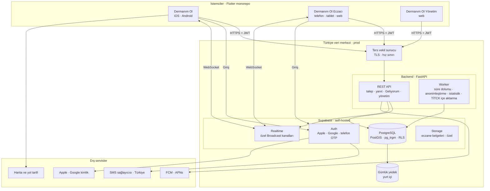

# Dermanım Ol: Teknik Mimari

> Durum: Taslak v1 · Tarih: 2026-11-02
> Dayanak: [01-urun-kararlari.md](01-urun-kararlari.md), [03-veri-modeli.md](03-veri-modeli.md)

---

## 1. Genel görünüm

---

## 2. Katmanlar

| Katman | Teknoloji | Görevi |
|---|---|---|
| Kullanıcı uygulaması | Flutter (iOS, Android) | Arama, liste, talep, yanıtları görme, "Geliyorum". Reçete okuma (OCR) **cihazda** (Google ML Kit). Talep geçmişi **cihazda** saklanır |
| Eczacı uygulaması | Flutter (telefon, tablet, web) | Gelen talepler, yanıt, "Geliyor" listesi, eczane profili, panel |
| Yönetim uygulaması | Flutter Web | Eczane onayı, katalog, raporlar, ayarlar. Giriş iki aşamalı doğrulamalı |
| Ortak paketler | `design_system`, `domain`, `data`, `core` | Renkler ve bileşenler, modeller, API ve Supabase istemcileri, hata yönetimi ve feature flag'ler |
| Ters vekil sunucu | Nginx ya da Traefik | TLS sonlandırma, IP bazlı hız sınırı, istek boyutu sınırı |
| Backend API | FastAPI (Python 3.12), Pydantic | Durum değiştiren **tüm** işlemler: talep gönderme, eczane eşleştirme, yanıt doğrulama, "Geliyorum", yönetim işlemleri. Supabase'e **service role** ile bağlanır |
| Worker | Aynı kod tabanı, ayrı süreç (APScheduler) | Süresi dolan talepleri kapatma, 24 saatte anonimleştirme, istatistik toplama, TİTCK içe aktarma, eski kayıtları temizleme |
| Veritabanı | PostgreSQL 15+, PostGIS, pg_trgm | Veri modeli `03-veri-modeli.md`. Okuma izinleri RLS ile |
| Kimlik | Supabase Auth | Apple, Google ve telefon OTP. SMS, **Send SMS Hook** ile Türkiye'deki bir sağlayıcıya yönlendirilir |
| Canlı güncelleme | Supabase Realtime (Broadcast) | `request:{id}` ve `pharmacy:{id}` özel kanalları. Mesajları backend yayınlar, kanal yetkisi RLS ile kontrol edilir |
| Dosya | Supabase Storage | Sadece eczane başvuru belgeleri, özel bucket. Kullanıcıdan dosya alınmaz |
| Push bildirim | FCM (Android, web), APNs (iOS) | Yeni talep, yeni yanıt, "Geliyorum", süre doldu |

---

## 3. Bir talebin teknik yolu

1. Kullanıcı uygulaması `POST /requests` çağırır (JWT ile). Gövde: kalemler, yaklaşık konum, yarıçap, filtreler.
2. API doğrular: rıza, telefon doğrulaması, günlük limit, bölge, kalem sayısı.
3. API, PostGIS ile uygun eczaneleri bulur (onaylı, yarıçap içinde, açık ya da nöbetçi, yükü 20'nin altında) ve en yakın 30'unu seçer. Tek transaction'da `requests`, `request_items` ve `request_targets` yazılır.
4. API her eczane için `pharmacy:{id}` kanalına maskeli talep yayınlar ve push bildirimi gönderir.
5. Eczacı uygulaması `POST /requests/{id}/responses` çağırır. API doğrular: üyelik, süre, muadilin aynı eşdeğer grupta olması, ilaçta fiyat yasağı.
6. API, yanıtı `request:{id}` kanalına yayınlar. Kullanıcının ekranı anında güncellenir, uygulama kapalıysa push bildirimi gider.
7. Worker, süre dolduğunda talebi kapatır ve bekleyen hedefleri `expired` yapar.
8. Worker, 24 saat sonra kullanıcı bağını ve konumu siler, anonim istatistiği yazar.

---

## 4. Ortamlar

| Ortam | Barındırma | Veri | Amaç |
|---|---|---|---|
| `dev` | Supabase Cloud + yerel Docker | Sentetik | Geliştirme |
| `staging` | Supabase Cloud | Sentetik | Test ve mağaza incelemesi |
| `prod` | **Türkiye'de bir veri merkezi**, self-hosted Supabase + Docker | Gerçek | Canlı |

MVP için prod başlangıcı: 2 sanal sunucu (biri uygulama, biri veritabanı), Docker Compose. Yük arttığında container orkestrasyonuna geçilir. Yedekler günlük, yurt içinde ve şifreli tutulur. Geri yükleme ayda bir test edilir.

---

## 5. Güvenlik

- Tüm trafik TLS ile. Mobil uygulamalarda sertifika sabitleme (pinning) prod için açılır.
- İstemciler sadece **anon key** ve kullanıcı JWT'si taşır. **Service role** anahtarı yalnızca backend ve worker'da, gizli anahtar yönetimiyle tutulur.
- RLS tüm tablolarda açık. Eczacı tarafı talep tablosunu doğrudan okuyamaz.
- Hız sınırı: IP başına (vekil sunucuda) ve kullanıcı başına (API'de).
- Yönetim girişi iki aşamalı doğrulamalı. Tüm yönetim işlemleri `audit_log` tablosuna yazılır.
- Loglarda kişisel veri tutulmaz: telefon numarası, konum ve ürün listesi maskelenir.
- Hata ve çökme takibi: kişisel veri ayıklanarak, tercihen yurt içinde barındırılan bir araçla.

---

## 6. Geliştirme ve dağıtım

| Konu | Seçim |
|---|---|
| Depo | GitHub, private monorepo. Flutter tarafı Dart pub workspace (kök `pubspec.yaml`) |
| CI | GitHub Actions: lint, test, build (Flutter, Python), migration kontrolü |
| Veritabanı değişiklikleri | `supabase/migrations` klasörü, Supabase CLI ile uygulanır |
| Mobil dağıtım | Fastlane ile TestFlight ve Google Play iç test kanalı |
| Web dağıtımı | Eczacı ve yönetim web uygulamaları statik olarak vekil sunucudan sunulur |
| API sözleşmesi | FastAPI'nin ürettiği OpenAPI şeması. Flutter istemcisi bu şemadan üretilir |

---

## 7. Açık teknik kararlar

1. Türkiye'deki barındırma sağlayıcısı ve SMS sağlayıcısı seçimi.
2. Harita: Google Maps SDK mı, açık kaynak MapLibre mı? (Lisans maliyeti ve veri yurt dışı aktarımı açısından değerlendirilecek.)
3. Çökme takibi aracı ve barındırma yeri.
4. Eczane programlarıyla (VERA, İLON vb.) otomatik stok yanıtı entegrasyonu Faz 2'de; bunun için API'de eczane bazlı servis hesabı tasarlanacak.
